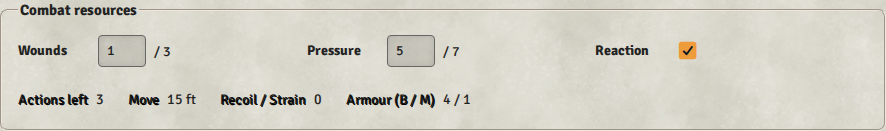
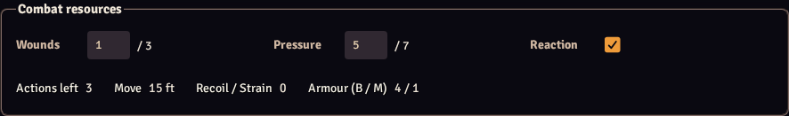

# Native UI review

Reviewed 22 October 2026 for v0.1.1.

FDERN uses Foundry's standard forms, tabs, fieldsets, disclosures, buttons, notifications, typography and both themes. System CSS arranges content and sizes grids; it does not supply a colour theme. Architectural references and source attribution are in [RESEARCH.md](RESEARCH.md).

## Findings and changes

| Finding | Result |
| --- | --- |
| Fixed sidebar and large button grids dominated the sheet | Compact header and resources; native tab navigation and action rows |
| General actions obscured weapon controls | Collapsible general actions; readied equipment first |
| Checkbox icons were absent in the initial preview | Visual harness loads the same core icon font as Foundry |
| Resource and long item labels wrapped awkwardly | Compact resource labels; stacked weapon fields |
| Observer buttons invited unauthorized edits | Owner-aware actions, portrait, item and purchase controls |
| Portrait image lacked native keyboard activation | Native button; keyboard tab navigation checked |
| Action choices and ammo source fields exposed raw IDs | Named ammo selector and action checkboxes |
| Live renders collapsed disclosures or saved wizard drafts out of order | Disclosure state retained; wizard saves queued as snapshots |
| Combat changes could leave open sheets stale | Combat lifecycle refreshes rendered actor sheets |
| Concurrent condition updates could duplicate statuses | Per-actor reconciliation queue and duplicate cleanup |
| Invalid Ready or empty-launcher checks spent Actions | Validation precedes resource spending |
| Cover Ally accepted opponents | Combat side validation with disposition fallback |

## Visual inspection

Production templates were rendered in Chromium with the official public demo's core stylesheet and icon font. Small resource, equipment-action, wizard-point, item-profile, encounter and geometry-dialog sections were inspected in light and dark themes, alongside full desktop and narrow sheets. Inspection led to the wrapping, icon, action-order and prompt-spacing corrections above.

The responsive harness covers 1100, 760, 600 and 460 px, keyboard navigation, observer restrictions, memory expansion, point spending and disclosure persistence. Rule/document tests, native compendium compilation and archive validation also run before publishing.

## Runtime boundary

This review uses a template/DOM harness, not a licensed Foundry server. Live multiplayer ownership, canvas geometry, native dragging, detached windows and module interoperability still require the checklist in [TESTING.md](TESTING.md).
