# Native UI review

## v0.2.5 — stylesheet delivery correction

The user’s runtime screenshot showed current templates under the original v0.1 CSS: the exact #14201d/#1c2a26 palette, old button styles and 128px portrait. Previous screenshots manually linked the current canonical CSS, so they did not catch a retained old stylesheet at that unchanged URL. Those earlier renders were template previews, not evidence of the user’s installed stylesheet.

The manifest now names a content-specific CSS file generated from styles/fdern.css. Validation and packaging verify the filename digest and byte equality. Native themes and working interactions are unchanged. After an update, reload the world page to load the new manifest stylesheet path.

The browser harness reads the manifest stylesheet, primes the previous URL with the original CSS, and verifies the header, portrait, inventory grid and icon dimensions. A separate before/after test applies the original CSS to the same current template, reproduces the reported green layout, removes that old stylesheet, then loads the manifest-declared layout.

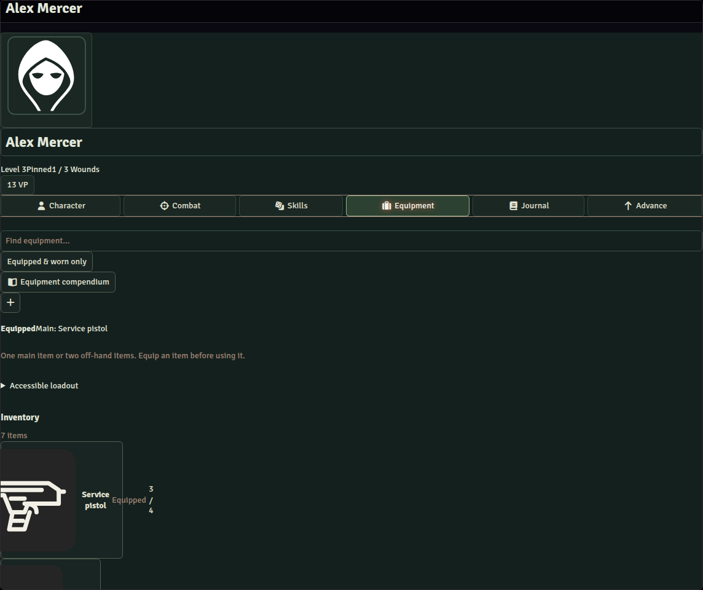

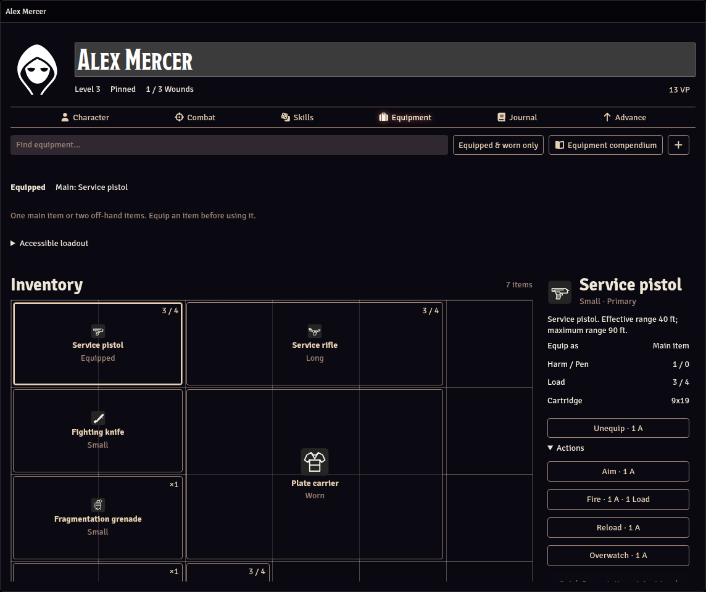

The browser checks still use a document/ApplicationV2 harness. This correction validates stylesheet delivery and layout; it does not claim direct access to the user’s Foundry instance.

## v0.2.4 — 22 October 2026

Nine new icons distinguish native condition states, especially Down and Prone. The status IDs and derived condition set remain identical. Reconciliation refreshes only old stock artwork on system-managed effects; custom and manual effects remain intact.

The wizard now previews each selected starting item, then repeats the artwork and concise profile in Review. Loadout changes save and refresh the preview while retaining keyboard focus. Text-only saves do not rerender. Review also caught a shield profile using an armour rating instead of its ballistic trait; the profile and regression assertion were corrected.

85 automated tests cover condition identity, idempotent artwork refresh, custom-art preservation and wizard reactivity. The browser harness passes 81 checks across four viewport widths, including live selection changes and review artwork. All 32 icons were inspected at 24, 32 and 48 pixels in native themes, along with wizard Loadout and Review.

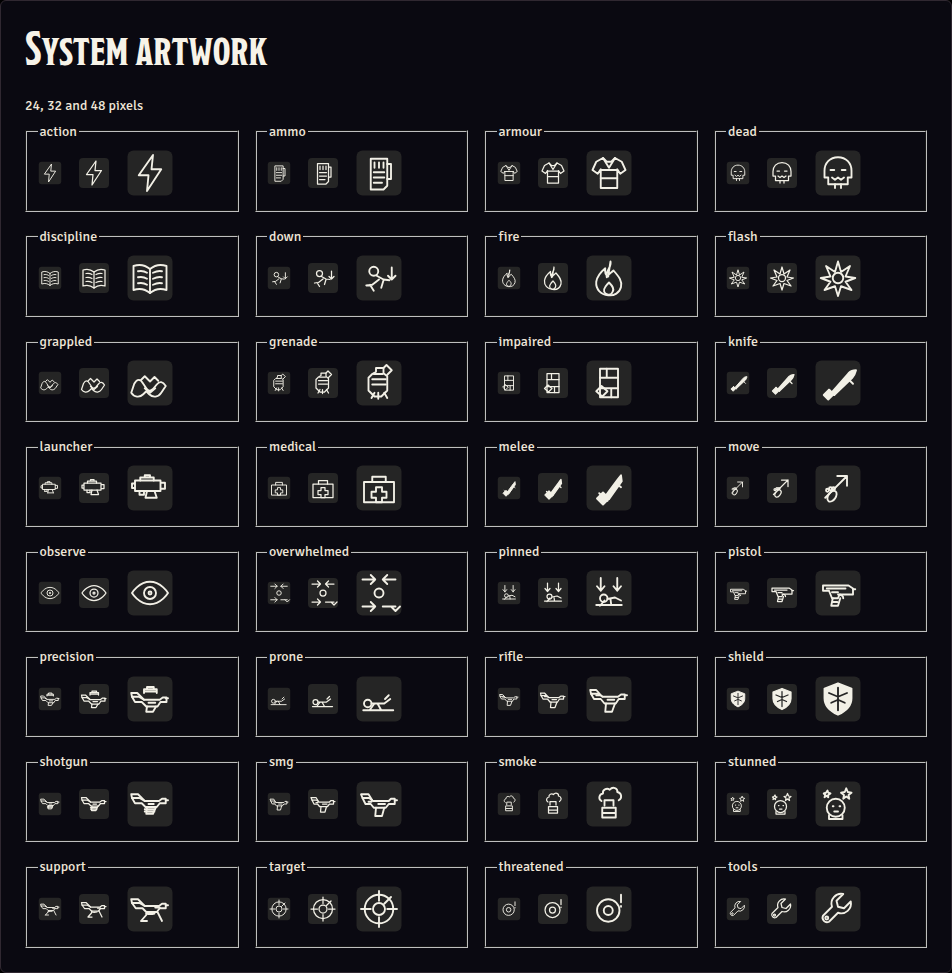

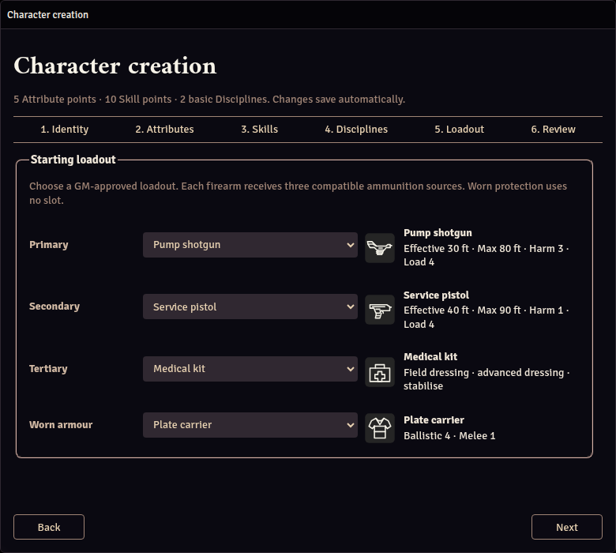

Live native token-HUD, multiplayer and canvas behavior still require verification in a licensed Foundry runtime.

## v0.2.3 — 22 October 2026

Three agent workstreams produced 23 original equipment/action SVG icons and the artwork resolver. Item profiles, inventory, chat, compendiums and new item hotbar macros share the same category artwork. Existing custom images and native character/NPC token defaults are preserved. All 162 compendium document IDs are unchanged.

82 automated tests cover asset mappings, XML validity, custom-art preservation and integration with item sheets and inventory. The 79 browser checks include loading every SVG in both native themes; contact sheets render each icon at 24, 32 and 48 pixels. Inventory and chat cards were inspected with the new artwork. The first visual pass prompted clearer firearm outlines and a native application background for the light-theme contact sheet. Inventory inspection also exposed a tile background override suppressing Foundry’s hover background; removing it restored the native hover contrast.

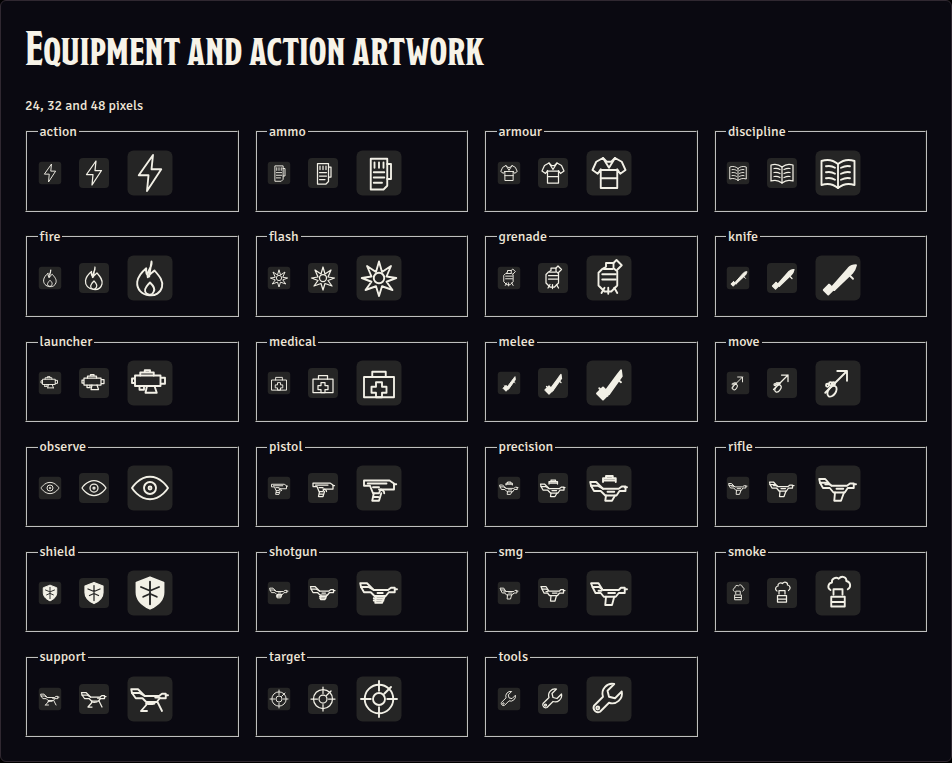

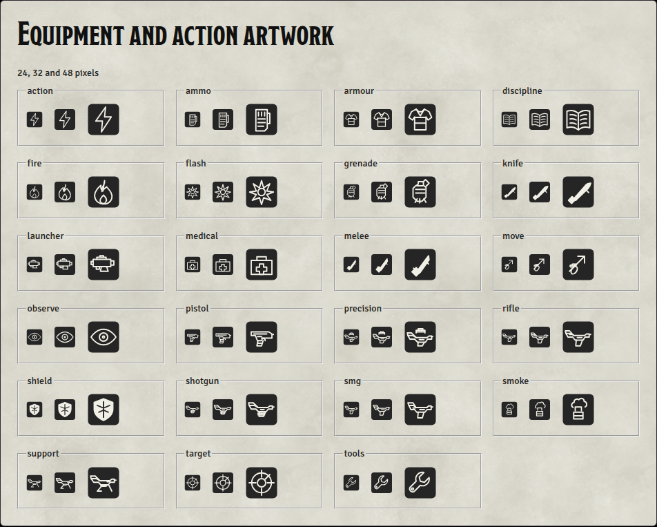

These checks use production templates and native Foundry CSS. Live multiplayer and canvas verification still require a licensed server.

## v0.2.2 — 22 October 2026

Equipped items can be used directly in the inventory inspector, with Action/Load costs and disabled-action explanations. Equip previews name the items that will be put away and share the execution plan with the backend. The equipped/worn filter, Escape and clear buttons, and Left/Right/Home/End selection reduce navigation. Accessible loadout preparation uses a native disclosure, keeping combat inventory compact.

77 automated tests verify rules, ownership, preview/execution parity, state transitions and sheet context. The browser harness checks 75 interactions and responsive cases at 1100, 760, 600 and 460 px, including direct inventory actions, keyboard focus, search reset and disclosure persistence. Visual inspection uses production templates and native light/dark Foundry CSS.

Review caught the disclosure handler overriding the initial open state and an equipment refactor reading state after mutation. Both were corrected before release, with regression coverage. A licensed Foundry instance is still required for live multiplayer and canvas verification.

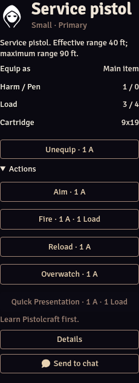

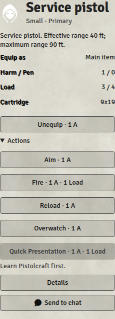

## v0.2.1 — 22 October 2026

Inventory cells are square, with theme-derived grid lines, empty cells and individually outlined footprints. An initial render exposed unresolved legacy border variables; deriving lines from the native text colour corrected both themes. Equipped equipment is listed separately from the three accessible storage slots. The item inspector offers Equip / Unequip for weapons, grenades and tools, and shows Main item or Off-hand. The editor provides a category override.

72 automated tests cover loadout capacity, swaps, ownership, action prerequisites and depleted grenades. 70 browser checks at 1100, 760, 600 and 460 px verify square cells and visible grid backgrounds alongside responsive layout and native sheet interactions. Production templates are rendered with native Foundry CSS; a licensed server remains necessary for multiplayer and canvas verification.

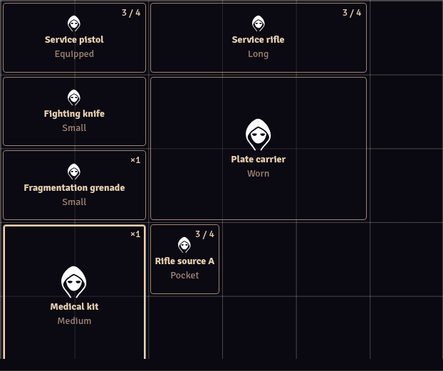

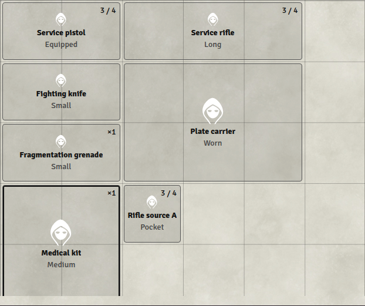

## v0.2.0 — 22 October 2026

The implementation replaces the dashboard summary with a character record: portrait and name, Attributes, character history, training and journal entries. The Equipment tab uses five item footprints and a selected-item detail panel. Foundry supplies the colours, themes, typography and controls. The default artwork is Foundry's token icon; custom artwork remains unchanged.

| Area | Implemented behavior |
| --- | --- |
| Character | Native headings and flowing character text; no summary dashboard or promotional prompts |
| Inventory | Pocket 1×1, Small 2×1, Medium 2×2, Long 3×1, Bulky 3×2; configurable per Item |
| Selection | Item details, equipment actions, quantities, armour and chat sharing in one panel |
| Ordering | Native Item sort order through Foundry's integer-sort helper; drag and keyboard controls |
| Chat | Structured roll and injury results; item-bound actions; repeat Skill rolls; GM injury undo |
| Macros | Send Equipment to Chat utility, alongside the existing action macros |

67 automated rule, document, ownership, chat and utility tests pass. Manifest, templates and module syntax validate; native compendium compilation and archive integrity checks pass.

### Visual inspection

Production templates were rendered using the official demo's public core stylesheet and icon font, with the runner's preinstalled Chrome. The responsive and interaction harness passed 69 checks at 1100, 760, 600 and 460 px. Character, Skills, Equipment, Journal and Advance were inspected at the top and bottom in both themes, alongside combat, wizard, item and chat sections.

Inspection confirmed all five footprints, selected-item controls, and the new character record. It caught a dark-theme inheritance issue in parchment chat messages; applying Foundry's native light theme to the card corrected text and button contrast. Zero-value modifiers were removed from roll cards. The three accessible loadout slots remain on one row at narrow widths.

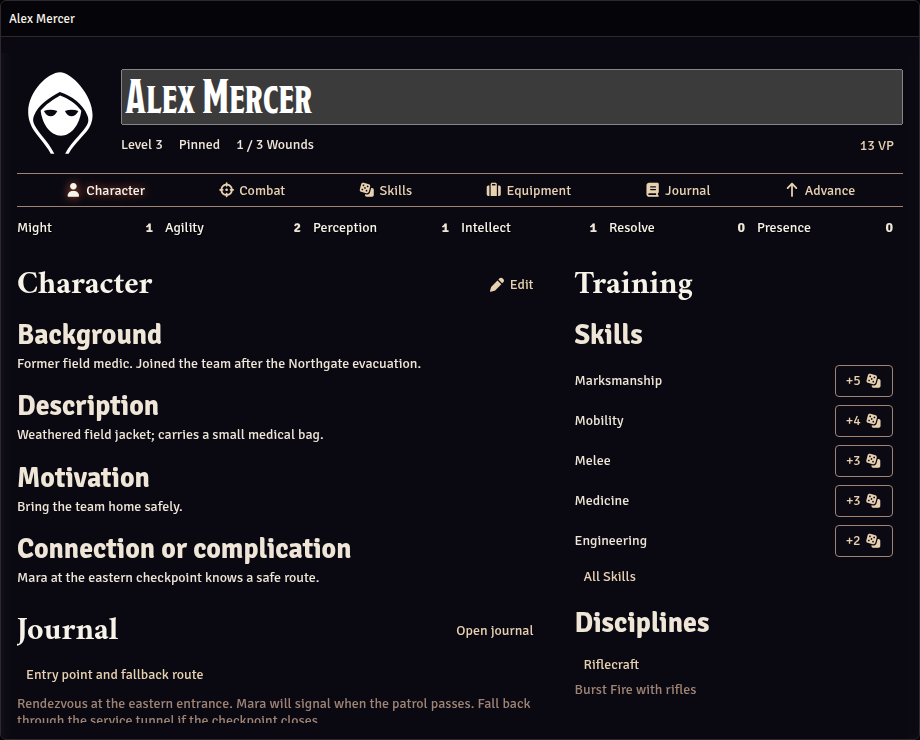

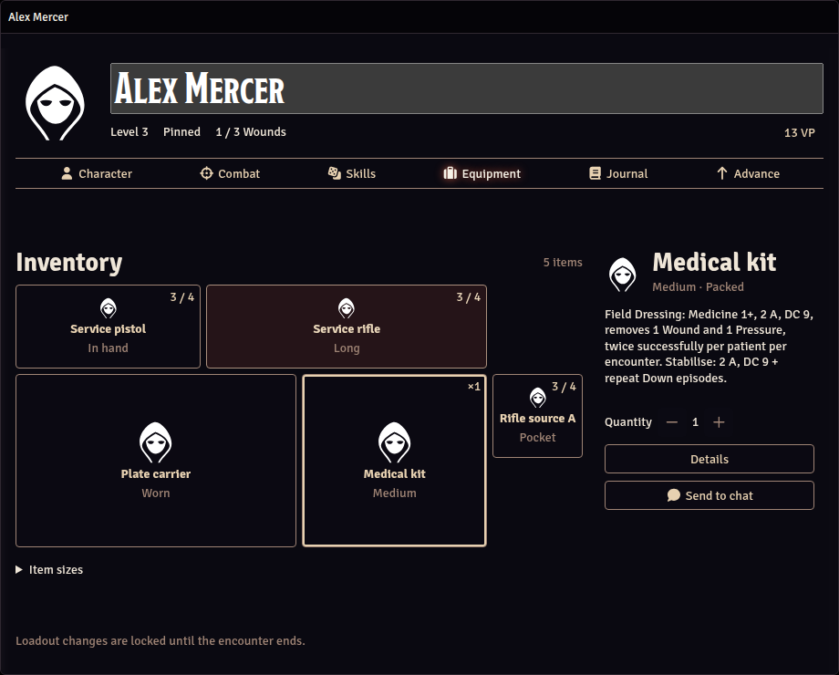

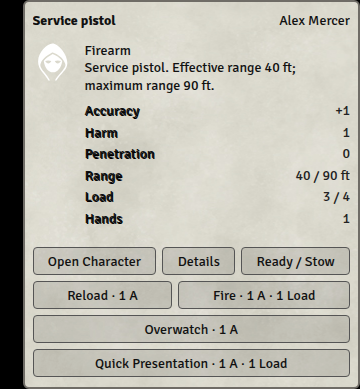

A licensed Foundry server is still needed for live multiplayer, canvas interactions, native dragging and module interoperability. The checklist is in [TESTING.md](TESTING.md).

## Previous review: v0.1.3

The previous interface passed 54 rule/document/lifecycle tests and 65 browser interaction and responsive checks at 1100, 760, 600 and 460 px. Production templates were inspected with the official demo's public core stylesheet and icon font in light and dark themes. Existing images in `docs/ui/` document that earlier interface, not the new v0.2.0 layout.
